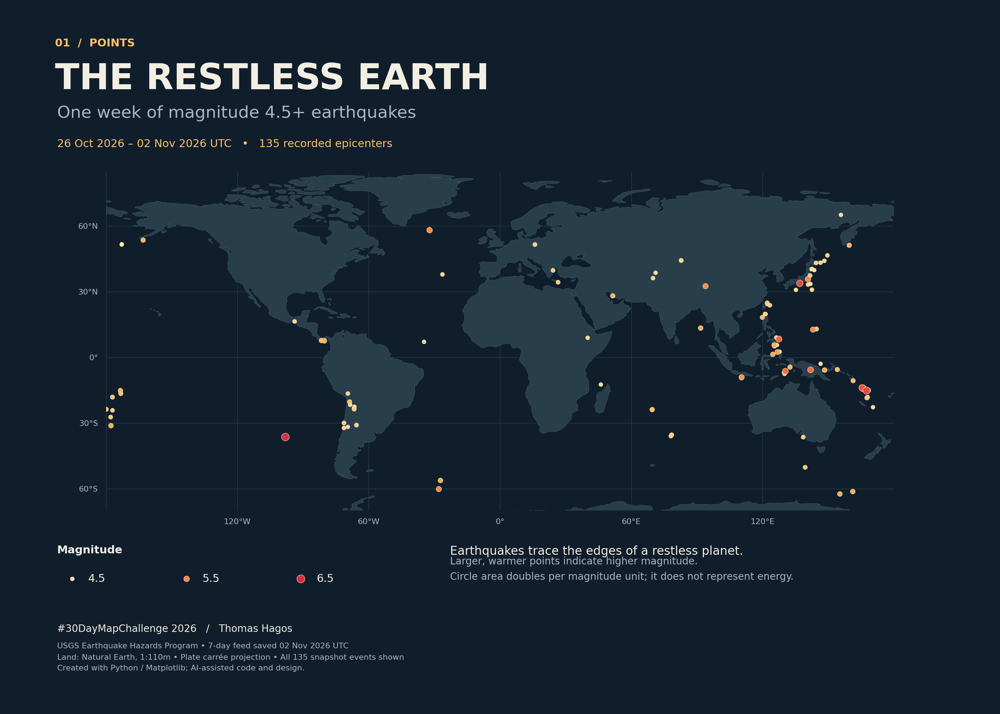

# 30 Days Mapping

## Maps

| Day | Theme | Map | Source |
| --- | --- | --- | --- |
| 01 | Points | The Restless Earth — below | `scripts/day01.py` |
| 02 | Lines | [The Nile, Connected](https://flex-commits.github.io/30-days-mapping/nile/) | [Code, sources and outputs](day02-nile/) |
| 03 | Polygons | [Africa, to Scale — review draft](day03-africa-to-scale/continents-draft/outputs/continents-individual-draft.png) | [Code, sources and methods](day03-africa-to-scale/continents-draft/) |

Day 2 is stored in `day02-nile/`, with its public page under `docs/nile/`. [Finding Support](https://flex-commits.github.io/30-days-mapping/finding-support/) remains a separate project under `day02-finding-support/`. The shared MUSA repository receives only the thumbnail, metadata and description.

Day 3 is a geographic feasibility draft in `day03-africa-to-scale/continents-draft/`. It compares continents at preserved area scale and distinguishes verified containment from partial overlays; it is not a final MUSA submission. [Draft findings and limitations](day03-africa-to-scale/continents-draft/docs/draft-results.md).

## Day 01 — Points: The Restless Earth

A map of magnitude 4.5+ earthquakes in a USGS rolling seven-day snapshot downloaded November 2, 2026. The snapshot contains 135 events. This is the Day 1 theme, not a claim that all events happened on November 1.

## Reproduce

Python 3.9 was used. From this directory:

```sh
python3 -m venv .venv
source .venv/bin/activate
pip install -r requirements.txt
MPLCONFIGDIR=.mplconfig python scripts/day01.py
```

The script reads saved GeoJSON files, so reproducing the same map does not require a new data download.

- `scripts/day01.py`: plotting code
- `data/earthquakes.geojson`: saved USGS earthquake feed
- `data/land.geojson`: Natural Earth land polygons
- `outputs/01-points-earthquakes.png`: full map
- `outputs/01-points-thumbnail.png`: 600 × 600 gallery thumbnail

## Sources

USGS Earthquake Hazards Program: https://earthquake.usgs.gov/earthquakes/feed/v1.0/summary/4.5_week.geojson
Feed documentation: https://earthquake.usgs.gov/earthquakes/feed/v1.0/geojson.php
Natural Earth 1:110m land (public domain): https://www.naturalearthdata.com/downloads/110m-physical-vectors/110m-land/
Downloaded GeoJSON: https://raw.githubusercontent.com/nvkelso/natural-earth-vector/master/geojson/ne_110m_land.geojson

## Cartography and limitations

Plate carrée projection; latitude extent −70 to 85 degrees; all 135 events are in view. Circle area doubles per magnitude unit (a design scale, not seismic energy). Warmer colors indicate higher magnitude. The USGS feed can be revised; this repository preserves the downloaded snapshot. AI assisted the code and initial design; assistance is disclosed in the map and submission.

## Gallery submission

Day 01 / Points — Thomas Hagos. Entry prepared for the [MUSA community gallery](https://github.com/weitzman-musa/30DayMapChallenge).

The thumbnail is a separate 600 × 600 composition. The full-resolution map is shown below.


