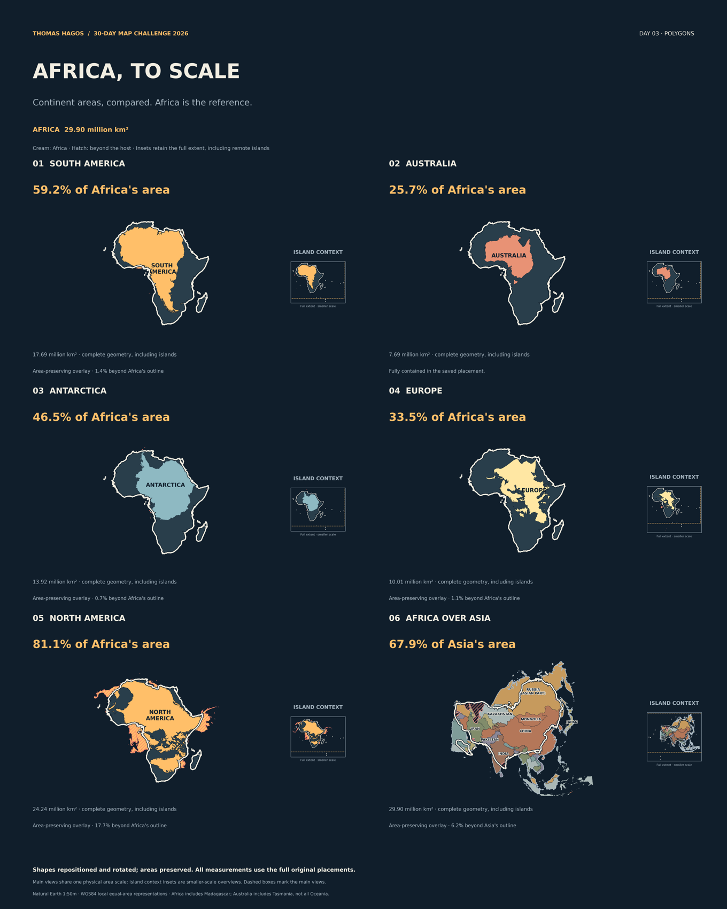

# Africa, to Scale
**Thomas Hagos · Day 03 / Polygons · MUSA 30-Day Map Challenge 2026**



How does Africa compare with the other continents? Five area-preserving overlays place South America, Australia, Antarctica, Europe and North America over Africa. The sixth reverses the comparison: Africa’s cream outline crosses a country-colored Asia. Each comparison continent appears once in the main composition.

[LinkedIn panels](outputs/linkedin/) · [High-resolution map](outputs/africa-to-scale.png) · [Asia country detail](outputs/asia-country-comparison.png) · [600 × 600 gallery image](outputs/03-thomas-hagos.png) · [Area table](outputs/continent-areas.csv) · [Asian country portions](outputs/asia-country-coverage.csv) · [Numerical validation](outputs/individual-validation.csv)

## Reading the map
Africa’s calculated surface area is **29.90 million km²**. South America is 59.2% of that area; Australia 25.7%; Antarctica 46.5%; Europe 33.5%; and North America 81.1%. Africa is 67.9% of Asia’s calculated area. Percentages compare area, not the amount of an outline that can be packed inside another.

The shapes are translated and rotated without changing their prepared areas. Australia is fully contained. The saved overlays contain 98.6% of South America, 99.3% of Antarctica, 98.9% of Europe and 82.3% of North America within Africa. The inverse overlay places 93.8% of Africa within Asia. Diagonal hatching identifies every portion beyond the host outline. These are measured arrangements, not proofs that no other arrangement could improve containment. The work makes no claim that every continent literally fits inside Africa.

The supplementary [paired comparison](outputs/continent-pairings.png) tests South America with Australia and Antarctica with Europe. It preserves visible protrusions and uses crosshatching for guest overlap. Its area totals must not be read as successful geometric packing.

## Presentation and island context
The main views are enlarged without changing their underlying geometry. A complete polygon component stays in the main view if it lies within 650 km of the largest component, or represents at least 1.5% of that continent’s area. This retains major islands such as Madagascar and Greenland in the main comparison. More distant small components remain visible in the labeled **full-extent island context inset**, with a dashed rectangle marking the main viewport. No mainland is cut into pieces and no component is removed from the calculations.

All six poster main views share one physical area scale. Context insets are explicitly **smaller scale**, so their visual sizes must not be compared with the main views. Each 1080 × 1350 LinkedIn panel uses one consistent area scale within its overlay, while its view scale varies across slides. Africa has a strong cream outline over the Asian countries. Area ratios lead the presentation; only Australia is labeled fully contained. Other saved placements remain area-preserving overlays with visible protrusions.

`data/processed/continents/presentation-component-audit.json` records main and remote component counts, areas, the display partition check, and the saved presentation policy. All placement geometry, area totals and containment results are unchanged by the presentation pass.

## Geographic definitions
Every coastline begins with **Natural Earth 1:50m Admin 0 Countries v5.1.1**, using its generalized de facto country/territory units. These are neither legal boundaries nor a statement endorsing sovereignty. Original country geometry is retained separately.

- **Africa:** source `REGION_UN=Africa` units plus France’s complete Mayotte and Réunion components. Includes Madagascar, source-listed regional island dependencies, remote islands and whole Egypt including Sinai. This is a specified source-country regional grouping, not a mainland or tectonic mask.
- **South America:** source South American units plus French Guiana; represented detached components retain their relative positions.
- **North America:** Greenland, Arctic islands, Central America and Caribbean source components are included. Hawaii is excluded.
- **Australia:** mainland, Tasmania and represented nearshore Australian components within 110–155°E and 45–9°S. This is Australia, not all Oceania; New Zealand, New Guinea and remote Australian territories outside that definition are excluded explicitly.
- **Europe/Asia:** Russia, Kazakhstan, Türkiye, Georgia and Azerbaijan are split by the saved mask tracing Natural Earth’s approximate Europe physical-region eastern boundary (Geographic Regions Polygons v5.0.0), extended through water and into the Arctic. Russian Far East components west of the antimeridian remain Asian. Other source-country island allocations are retained; Cyprus is Asian and Greek islands European. This is a disclosed continental convention, not a unique natural or legal boundary.
- **Antarctica:** the source country feature plus Natural Earth perennial ice shelves, embedded archive **v4.1.0**, with 2003–04 Mosaic of Antarctica lineage. Seasonal sea ice is excluded. The source web page labels this download v4.0.0; the archive version is recorded rather than silently replaced. The outline is a historical source extent, not a present-day ice-front survey.

Area means **WGS84 ellipsoidal surface area of the assembled continent polygons after consistently filling interior rings**. This includes enclosed inland water and is not dry-land area. Water open to the coastline or continental divider remains outside. Ring filling is applied uniformly before computing target areas; no component is selectively removed to obtain a fit. The audit measures the effect (effectively zero for Africa). Original source holes and filled comparison geometries are separate files. Full membership and exclusions are in `data/processed/continents/component-membership.json`.

## Projection and geometry
Edges are geodesically densified to at most 10 km. Each continent uses a locally centered WGS84 Lambert azimuthal equal-area projection in metres; centers are saved in `config.json` and exact frames in `projection-frames.json`. Tiny numerical normalization matches the prepared shape’s area to its calculated ellipsoidal target. Factors are roughly 1.0000001 linearly and are saved per continent. They do not depend on fitting.

Preparation logs geometry repairs, their absolute/relative area effects and a 0.01 m numerical precision grid. A final minute normalization preserves the target area after preparation. Thereafter only rigid translation and rotation are allowed. No mainland is cut, clipped, stretched or arbitrarily scaled. Display simplification is **zero**; an 18 km simplified proxy accelerates bounded searches but never supplies displayed polygons or reported containment metrics. Proxy and ring-filling effects are measured separately.

Locally centered equal-area representations distort shape and direction. Moving these planar outlines is an area comparison, not an exact relocation on the ellipsoid. The main map uses equal physical area scale across its six main views, with separately scaled context insets. Source resolution is generalized, so rounded million-km² values are appropriate.

## Asian countries
All Asian country pieces share Asia’s single projection and frame. The moved Africa outline is intersected with these pieces; Russia and other split units refer to their Asian portions only. The table records covered area, percentage, uncovered area and whether the Asian source piece is entirely covered. Enclosed water and small numerical geometry differences remain unattributed rather than being assigned to countries by invention. Country colors supply context; covered portions are not whole-country equivalents.

## Validation and reference checks
The source has 242 unique identifiers and valid raw geometry. The assembled geographic continents have zero measured pairwise area overlap. Placed full-resolution display geometries remain valid and preserve prepared area within a relative threshold of 1e-12. A complete-containment label requires **exactly zero** computed outside area and overlap; partial overlays retain their measured protrusions. Geometry repairs and approximately 0.41 km² of Asia country-to-continent preparation-edge differences are disclosed in the audit.

[Independent area checks](outputs/published-area-checks.csv) compare all seven calculated areas with the historical NAEP/Nystrom atlas table, without using it to resize shapes. Most differences are below 1.2%; Europe differs by about 4.2%. That table is labeled land area and uses a different continental/island grouping, so exact equivalence is not claimed. Continental divisions, water conventions, source coastline detail and the historical reference limit direct comparison. A separate Geoscience Australia check differs by about 0.038% for Australia. These checks establish reasonable magnitudes, not certification of a universal continent area.

`docs/clean-rebuild.json` records a fresh-directory reproduction from frozen archive checksums, saved configuration and placements. Original geographic, assembled, projected, display and layout geometries are separately retained. Projected GeoJSON uses metre coordinates in local frames and is not RFC 7946 longitude/latitude interchange data.

## Reproduce
Python runtime and exact dependencies are in `docs/environment.txt` and `requirements.txt`.

```sh
python3 -m venv .venv
source .venv/bin/activate
pip install -r requirements.txt
python scripts/download_frozen.py
python scripts/prepare_continents.py
python scripts/replay_and_validate.py
python scripts/country_coverage.py
python scripts/audit_geography.py
python scripts/proxy_audit.py
python scripts/reference_checks.py
python scripts/render_continents.py
python scripts/build_page.py
python scripts/clean_rebuild_check.py
```

Raw downloads are excluded from Git. The downloader verifies exact frozen SHA-256 values and stops if upstream bytes change. Source manifest entries record publisher, embedded version, resolution, exact URL, retrieval date, terms, coverage and limitations. Saved placements reproduce the composition without an optimization run. To repeat bounded searches, run `test_layouts.py` followed by `test_individuals.py`; seeds and finite trial limits are in the configuration. No claim of globally optimal packing is made.

## Credits
Made with Natural Earth: [source downloads](https://www.naturalearthdata.com/downloads/) and [public-domain terms](https://www.naturalearthdata.com/about/terms-of-use/). Independent numeric references are attributed in the check table; copyrighted reference atlas artwork is not reproduced. Typography uses DejaVu Sans with its included license. Thomas Hagos designed the concept and series; AI assisted code and editorial production. The map belongs to the broader area-comparison tradition and uses an original arrangement rather than copying an existing “True Size of Africa” composition.

For the MUSA gallery, only the dedicated thumbnail and Markdown entry belong in the shared repository. Code, geometry and full exports remain in Flex-commits/30-days-mapping.
