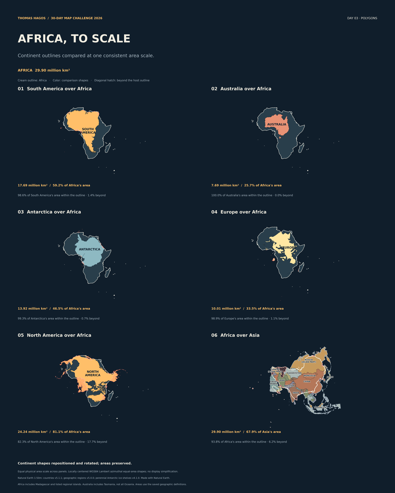

Six continent comparisons at one area scale. Five overlays place South America, Australia, Antarctica, Europe and North America over Africa; the sixth reverses the perspective, placing Africa over country-colored Asia.

The complete shapes are repositioned and rotated with their calculated areas preserved. Hatching marks portions beyond the host outline: relative area does not guarantee literal containment. Africa includes Madagascar and the documented regional islands; Australia includes Tasmania rather than all Oceania.

[Full-resolution map](https://github.com/Flex-commits/30-days-mapping/blob/main/day03-africa-to-scale/outputs/africa-to-scale.png) · [Asia country detail](https://github.com/Flex-commits/30-days-mapping/blob/main/day03-africa-to-scale/outputs/asia-country-comparison.png) · [Methods, data and reproduction](https://github.com/Flex-commits/30-days-mapping/tree/main/day03-africa-to-scale)

Made with Natural Earth 1:50m. WGS84 ellipsoidal areas and locally centered equal-area representations; saved rigid placements, geographic definitions and numerical checks accompany the source code.
