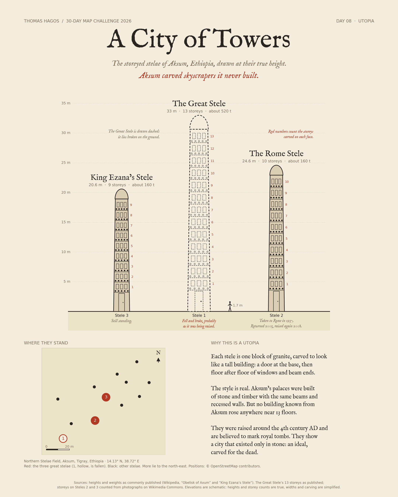

# Day 08 · Utopia — A City of Towers

The storeyed stelae of Aksum, Ethiopia, drawn at their true height. Each stele is one granite block carved to look like a multi-storey building. No building known from Aksum rose anywhere near that tall: the stelae show a city that existed only in stone.



## Figures

| Stele | Height | Storeys | Weight | Status |
|---|---|---|---|---|
| 3 · King Ezana's Stele | 20.6 m | 9 | about 160 t | standing |
| 1 · The Great Stele | 33 m | 13 | about 520 t | fallen and broken |
| 2 · The Rome Stele ("Obelisk of Axum") | 24.6 m | 10 | about 160 t | taken to Rome 1937, returned 2005, re-erected 2008 |

## Method

- Heights and weights are the commonly published figures (Wikipedia, "Obelisk of Axum" and "King Ezana's Stele"; secondary sources for the weights).
- The Great Stele's 13 storeys are as published. Storeys on Steles 2 and 3 were counted from photographs on Wikimedia Commons, as rows of windows above the false door. Published counts for these two vary between sources.
- Elevations are schematic: heights and storey counts are true; widths, taper and carving are simplified.
- Positions in the plan come from OpenStreetMap (`historic=monument` nodes, downloaded 2026-11-09, © OpenStreetMap contributors, ODbL), saved in `data/stelae-osm.json`. The plan is cropped to the main group around the three great stelae.

## Run

```bash
python3 -m venv .venv && .venv/bin/pip install -r requirements.txt
.venv/bin/python scripts/render.py
```

Fonts: IM FELL English (SIL OFL 1.1), DejaVu Sans.
